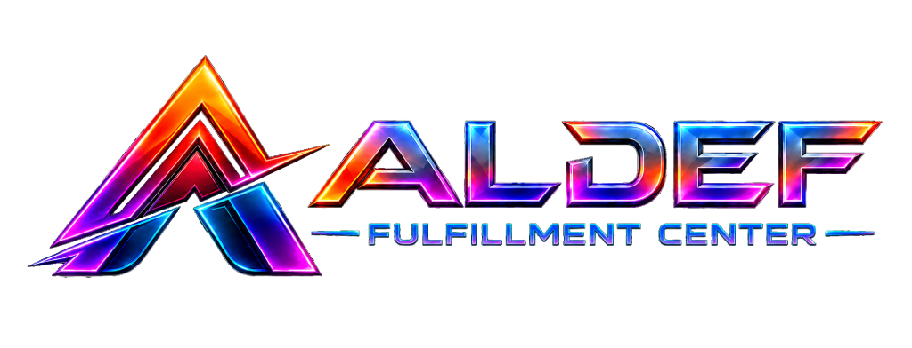

  

  <strong>Satu kendali. Setiap pergerakan.</strong> 
  Backend REST API untuk ALDEF Fulfillment Center.

  
  
  
  
  

## Tentang Aldef Tech

**Aldef Tech** adalah mitra transformasi digital yang membantu bisnis merancang, membangun, dan mengembangkan teknologi sesuai kebutuhan operasionalnya. Kami menggabungkan pemahaman proses bisnis dengan software engineering untuk menghasilkan solusi yang efektif, scalable, aman, dan mudah dikembangkan dalam jangka panjang.

Mulai dari validasi kebutuhan hingga deployment dan dukungan pascapeluncuran, setiap solusi dirancang untuk menyederhanakan pekerjaan, menghubungkan data, mengurangi proses manual, dan membantu perusahaan mengambil keputusan dengan lebih cepat.

### Fokus layanan

- **Custom Software Engineering** — sistem bisnis yang mengikuti alur kerja dan kebutuhan unik perusahaan.
- **Web Application & SaaS Development** — aplikasi web modern dan platform multi-tenant yang siap berkembang.
- **AI Solutions & Intelligent Automation** — integrasi AI, knowledge base, AI agent, dan otomasi proses bisnis.
- **Business Process Automation** — digitalisasi workflow, approval, pelaporan, dan pekerjaan berulang.
- **System Integration & Enterprise API** — integrasi ERP, payment gateway, WhatsApp, sistem legacy, dan layanan pihak ketiga.
- **Modernization & Performance Tuning** — refactoring aplikasi lama, peningkatan performa, keamanan, dan kesiapan skala.

## Tentang Repositori

Repositori ini berisi source code **backend** [ALDEF Fulfillment Center](https://wms.aldeftech.com), sistem manajemen gudang (WMS) multi-klien dan multi-gudang. Backend menyediakan REST API `/api/v1` dengan autentikasi session SPA (Sanctum) yang dipakai oleh frontend React di repositori [WMS-FE](https://github.com/aldef-deni/WMS-FE).

Fitur utamanya meliputi:

- dashboard operasional: KPI stok, antrean, SLA, kapasitas gudang, stok rendah, expiry, dan ringkasan keuangan;
- master data klien, gudang, zona/lokasi/bin, SKU dengan barcode, varian, dimensi, serial, serta rotasi FIFO/FEFO;
- inbound: ASN, jadwal kedatangan, receiving parsial, QC kondisi, putaway, dan lampiran dokumen;
- persediaan per lokasi, batch, serial, dan kondisi dengan kartu stok (ledger), reservasi, mutasi, replenishment, dan transfer antar gudang;
- outbound: order manual/CSV, alokasi dan backorder, wave picking, scan lokasi/SKU, packing, manifest, label Code128, dispatch, dan tracking;
- retur dan inspeksi, stock opname blind count, serta adjustment dengan approval oleh petugas berbeda;
- billing berbasis aktivitas: snapshot tarif, biaya penyimpanan harian terjadwal, invoice bulanan, dan pencatatan pembayaran;
- portal klien dengan pembatasan data per klien, laporan CSV/Excel/PDF, dan ekspor besar melalui queue;
- role-based access dengan 14 role bawaan, penugasan klien/gudang per pengguna, dan audit log;
- profil pengguna: data pribadi, foto profil, ganti password, sesi aktif, dan riwayat aktivitas;
- akun demo Super Admin yang datanya otomatis kembali ke data default 24 jam setelah login.

## Demo

Coba langsung di **[wms.aldeftech.com](https://wms.aldeftech.com)** dengan tombol **Coba akun demo** pada halaman login:

| Email | Password |
| --- | --- |
| `demo@aldeftech.com` | `demo` |

Data yang Anda ubah dengan akun demo akan dikembalikan ke data default 24 jam setelah login.

## Teknologi

| Area | Teknologi |
| --- | --- |
| Backend | PHP 8.4, Laravel 13 |
| Autentikasi | Laravel Sanctum 4 (session SPA + CSRF) |
| Database | MySQL 8.4 |
| Queue & scheduler | Laravel database queue, Laravel Scheduler |
| Dokumen | PDF operasional dan label pengiriman Code128 |
| Testing | PHPUnit 12 |

## Kustomisasi

  <strong>JIKA BERMINAT UNTUK KUSTOMISASI BISA MENGHUBUNGI DENI AFRIZAL</strong>

  

## Kontak

Punya kebutuhan sistem, aplikasi, SaaS, integrasi, atau otomasi AI? Kunjungi [aldeftech.com/contact](https://aldeftech.com/contact) untuk mendiskusikan kebutuhan bisnis Anda bersama Aldef Tech.

---

  © Aldef Tech. Seluruh hak cipta dilindungi.

